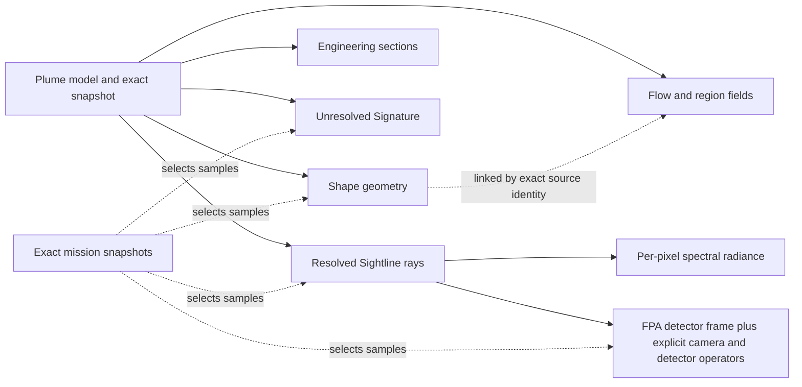

# Visualization survey v1

Status: product and view survey. Snapshot date: 2026-11-18.

This survey organizes the exhaust-plume data products and the major ways a
person should inspect them. It is an in-repository product survey, not a
survey of external visualization software. A *product* is a typed, source-
bound result; a *view* is a reproducible rendering of that result. Multiple
views may be offered for one product, and one gallery may link several
independent results when their lineage and axes are compatible.

The survey complements the [Radiant Plume capability map](radiant_plume.md),
the [visualization evaluation plan](visualization_evaluation_plan_v1.md), and
the [five-lane model visualization standard](model_visualization_standard_v1.md).
Those documents remain the detailed sources for branding, contracts, and
view-level rules.

The [visualization demo backlog](visualization_demo_backlog_v1.md) ranks the
work for a live walkthrough of Shape, Signature, and detector output.

## Product-to-view map

| Product or data family | What the result means | Main viewer experience | Useful views and interactions | Boundary to keep visible |
| --- | --- | --- | --- | --- |
| **Radiant Plume Shape** — `plume.visual.sectioned-tube@1` | Oriented centerline sections, radii, bounds, and optional declared features | **Shape Explorer** | 3-D tube; XY/XZ/YZ projections; centerline and radius traces; station inspector; feature-channel plots; mesh checks | The envelope is display geometry. It does not imply conservative support, shock topology, plume end, radiation, or detector response unless those are separately returned. |
| **Flow and region fields** — `plume.visual.model-lane@1`, `plume.spatial.axisymmetric-zone-field@1`, `plume.spatial.local-field@1` | Solver-retained zones/cells, physical channels, sample points, masks, and named paths | **Flow-field Explorer** | Exact region/cell maps; field maps for declared channels; axial/radial slices where supported; local point maps; channel and station inspectors; boundary/path overlays; uncertainty and residual panels | Show the source sampling semantics. Do not interpolate between zones or turn a 2-D field into a 3-D field unless the result explicitly supports that operation. Unavailable views are explicit. |
| **Spatial support and projected area** — `plume.spatial.support@1`, `plume.spatial.projected-area@1` | Declared support bounds or a projected scalar area | **Support / Footprint Inspector** | Three orthographic support projections; bounds and extent cards; projected-area value and closed-zone count | Support is not a flow solution. Area alone does not encode shape, viewing direction, radiance, or an image. |
| **Engineering flux sections** — `plume.engineering.flux-section@1` | Conservative section quantities at requested centerline stations | **Engineering Section Explorer** | Section pose/normal; momentum vector and magnitude; second-moment ellipse; mass/species/energy flow; pressure/residual cards; exact station selector; ordered series when explicitly supplied | Preserve requested stations and failed samples. Do not add interpolated points or present engineering quantities as a measured image. |
| **Radiant Plume Signature** — `plume.signature.spectral-radiant-intensity@1` | Unresolved spectral radiant intensity over wavelength and source-to-observer direction | **Signature Explorer** | Spectrum by selected direction; wavelength-by-direction heatmap; direction-sphere map; masks and uncertainty; exact-time angular map and exact-direction timeline trace | This is source radiant intensity, not per-ray radiance. Keep wavelength units, exact direction vectors, time, masks, uncertainty, and table/model provenance. |
| **Sightline** — `plume.optical.spectral-ray-transfer@1` | Resolved per-ray source radiance and background transmittance over wavelength | **Ray / Sightline Inspector** | 3-D ray bundle; selected-ray origin and direction; source-radiance spectrum; separate background-transmittance spectrum; ray-by-wavelength maps; exact route intervals when returned | Source radiance and background transmittance are separate. A zero or missing value does not by itself establish a miss, opacity, or optical depth. |
| **Per-pixel spectral radiance** — `plume.image.spectral-radiance@1` | Source-only spectral radiance sampled at declared pixel row/column coordinates, bound to exact rays and pixel geometry | **Radiance Image Viewer** | Selected-wavelength radiance and transmittance maps; validity map; selected-pixel spectra; row/column selection; exact JSON/CSV export | Pixel indices do not imply physical image coordinates or angles. This pre-detector product is not detector electrons or ADC counts. |
| **Focal-Plane Array** — `plume.fpa.detector-frame@1` | Downstream expected detector-electron layers, masks, variance, and optional deterministic digitization | **FPA / Detector Viewer** | Expected-electron image; dark-current and variance layers; detector spectral response; exposure view; saturation/validity masks; optional ADC image; pixel inspector | Keep this downstream of an explicitly bound source/ray and detector operator. Expected values and deterministic counts are not measured detector data or a noise realization. |
| **Mission-time and comparison collections** | Compatible exact snapshots or independently produced results | **Timeline and Compare** | Exact-time playback; trajectory and declared source-pose trace; aligned provider/fidelity overlays; difference/residual panels when measurement domains match | Never blend fidelities or interpolate through invalid samples silently. Every sample keeps its own source identity, status, and claim ceiling. |

These rows describe viewer families, not a promise that every provider returns
every field. The result contract and source data determine which panels can be
shown for a particular case.

## The intended viewer suite

The major user-facing visualization products should be organized as a small
set of linked, purpose-specific viewers:

1. **Shape Explorer** answers *where is the plume envelope and how does it
   change along its centerline?* It is the entry view for geometry and
   declared geometric features.
2. **Flow-field Explorer** answers *what state or region data did this model
   actually retain?* It exposes exact cells, points, channels, slices,
   paths, and missingness.
3. **Signature Explorer** answers *how does unresolved source emission vary
   by wavelength, direction, and time?*
4. **Sightline Inspector** answers *what radiance and background
   transmittance did each requested ray return?*
5. **Radiance Image and FPA Viewers** answer, separately, *what source-only
   radiance was sampled per pixel?* and *what detector-frame quantities
   result after camera, exposure, and detector operators?*
6. **Engineering and Compare views** answer *what section-integrated
   quantities or cross-provider differences are supported by the supplied
   requests and results?*

These viewers can share selection patterns, provenance panels, and export
behavior. They should not be collapsed into one undifferentiated “plume
image”: a geometry mesh, a spectral signature, a ray transfer result, a
radiance image, and a detector frame are different physical quantities.

## Data-flow relationship

The dotted links indicate optional collection/selection, not automatic
conversion. Per-pixel radiance and an FPA frame are separate outputs from
source-bound ray data: FPA also requires its explicit camera and detector
operators. Unresolved Signature and resolved Sightline have different
measurement quantities; any comparison needs a declared bridge and common
measurement space.

## Cross-cutting view requirements

Every gallery or export should make these inspectable:

- source capability, schema/version, provider, model lineage, fidelity, and
  validation level;
- exact request/result or snapshot identity, digest, frame, and time;
- status, applicability, warnings, validity masks, and unavailable values;
- quantity, unit, axis convention, and the measurement space represented;
- view settings such as selected indices, scale, colormap, camera, and any
  resampling or binning policy.

Invalid values remain masked or blank. Uncertainty is shown only when supplied
and is not relabeled as confidence. Comparisons require compatible quantities,
units, coordinate frames, and sample domains; every result retains its own
lineage and fidelity label.

## Current coverage and open acceptance

The repository already has static galleries for the canonical product and
supporting spatial families, a common five-lane model gallery, linked
standalone explorers for the primary result families, exact-sample mission
and Signature timeline views, and separate FPA renderers. The
[evaluation plan](visualization_evaluation_plan_v1.md) and
[completion plan](product_suite_completion_plan_v1.md) record the detailed local coverage.

Local renderer, adapter, and browser coverage does not establish physical
provider agreement. Provider-observation comparisons remain open; the
roadmap also records a remaining canonical ray-route browser/export check.
FPA measured-image acceptance depends on source-bound detector observations
and metadata that are not present in the current evidence set. Keep those
acceptance states distinct from a gallery that renders successfully.

## Suggested review checklist

For each proposed view, record:

1. Which result contract and exact source data populate it?
2. What question does the view answer?
3. Which fields, units, axes, masks, uncertainty, and lineage are visible?
4. Which operations are exact selection, and which perform derived sampling?
5. What is explicitly unavailable for each provider/fidelity lane?
6. What claim does the view support, and what validation evidence is still
   missing?
